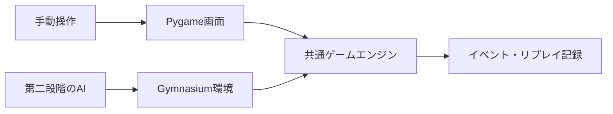

# 環境と設計

この文書は実装方針。記載する構成・API・保存形式は未実装であり、ゲームルールの確定を意味しない。

## 開発環境

| 用途 | 第一段階 | 第二段階 |
| --- | --- | --- |
| OS | Windowsで開発・手動プレイ | 同じ環境で開始。必要なら別の計算環境へ移行 |
| 言語 | Python 3.12 | 同じPython環境 |
| 環境管理 | uv、プロジェクト専用 `.venv` | 学習用の追加依存を同じプロジェクトで管理 |
| ゲーム処理 | Python。配列表現が必要ならNumPy | 同じエンジンを描画なしで使用 |
| 画面 | Pygame | 同じ画面でAI観戦・リプレイ |
| 検証 | pytestで観察由来の遷移を確認 | 環境API、評価、手動プレイとの一致を追加 |
| AI | 導入しない | Gymnasium、PyTorch、Stable-Baselines3 |
| 実験記録 | ルール版、操作・生成・イベントのログ | 学習設定、seed、モデル、評価結果、TensorBoard |

現在の環境にはPython、uv、Node.jsが見つかっているが、ライブラリの互換性やGPU利用可否は未検証。Node.jsはこの構成では必須にしない。GPUの購入や環境移行は、CPUでの処理速度を測定してから判断する。

実装開始時に、依存関係を `pyproject.toml` に定義し、解決したバージョンを `uv.lock` で固定する。最初から学習用パッケージを必須にせず、追加依存グループとして管理する。

参考資料:

- [uvのプロジェクト管理](https://docs.astral.sh/uv/concepts/projects/)
- [Pygame公式ドキュメント](https://www.pygame.org/docs/)
- [Gymnasiumのカスタム環境](https://gymnasium.farama.org/main/introduction/create_custom_env/)
- [PyTorchのインストール案内](https://pytorch.org/get-started/locally/)
- [Stable-Baselines3 DQN](https://stable-baselines3.readthedocs.io/en/master/modules/dqn.html)
- [SB3 Contrib MaskablePPO](https://sb3-contrib.readthedocs.io/en/master/modules/ppo_mask.html)

## 共通エンジン



盤面遷移を画面や学習コードへ重複実装しない。エンジンはPygame、Gymnasium、PyTorchをインポートせずに動かせる設計にする。

落下・合体・重力・消去などの処理順は実機確認に合わせて決める。画面はエンジンが返す状態とイベントを表示し、フレームレートで論理結果が変わらないようにする。

通常プレイに時間進行が必要なら、経過時間を明示的な入力として渡す。診断用の停止・1手送りと通常プレイを区別し、待機が勝手に無限になるなどの仕様差を隠さない。

## 状態とルール設定

ゲーム状態の候補:

- 盤面、現在ブロック、予告列、得点、受理した手数、ゲーム終了状態。
- 確認された仕様に必要な過去最大値、生成候補の段階、消去段階。
- 時間進行がある場合のタイマー、落下状態、入力予約。
- 乱数生成器の状態、リプレイ用の明示的な生成列の位置。

進行履歴に依存する状態は、盤面から推測して省略しない。保存・復元・診断用の読み込みでも保持する。

ルール設定には識別子と版を付け、盤面サイズ、合体・連鎖の方式、消去条件、生成候補と重み、得点、終了条件、時間条件を定義する。確認状態は[台帳](GAME_RULES.md)のルールIDへ対応付ける。

初期の実装は読みやすさを優先する。整数の数字をそのまま保存し、第二段階でAIの観測へ変換する。空マスは `0` とする。盤面の座標は `[row][column]`、上から下・左から右、APIの添字は0始まりとする。

## 第一段階の操作と診断機能

通常プレイではマウスで列を選び、キーボードでも左から1～5の列を選べるようにする方針。実機の列数が異なれば設定に合わせて変更する。画面に盤面、現在値、予告、得点、進行状態、終了状態を表示する。

診断機能は次を用意する。

- 任意の初期盤面と必要な進行状態を読み込む。
- 生成列を指定し、乱数を使わずに同じ手順を再生する。
- 停止、1手実行、解決イベントの確認、ログ保存を行う。
- 使っているルール設定と未確認のルールIDを表示する。

診断用に原作では作れない盤面も設定できるが、その結果を原作の挙動の証拠にはしない。通常プレイのハイスコアと診断結果は区別する。

## 記録と再現

ログに含める項目:

- ログ形式の版、エンジンの版、ルール設定の内容または識別可能なハッシュ。
- 初期状態、seed、生成されたブロック列、受理・拒否した入力。
- 必要な入力時刻・経過時間、状態の変化、得点差、解決イベント、終了理由。

seedだけでは、ルールや乱数呼び出し回数の変更後に再現できない場合がある。生成値を保存し、明示的な生成列でも再生できるようにする。

形式はJSONの設定・状態とJSON Linesのイベント記録を候補とする。エンジンの合体イベントなどの実際の構造は、処理順を確認してから定義する。

## 第二段階への接続

Gymnasiumの `reset(seed=...)` と `step(action)` を通して共通エンジンを操作する。観測には盤面、現在・予告ブロック、ルール上必要な進行状態を含める。ブロックの指数表現はAI入力の変換として扱い、画面とログには実際の数字を残す。

原作で表示されない将来の生成列や乱数状態はAIに渡さない。追加の内部状態を渡す実験は、人間と同じ情報での実験と区別する。

合法な行動は終了条件の確認後に定義する。満杯列でも合体できる仕様なら高さだけで除外しない。ゲームオーバーになる合法手を単に除外して原作の行動を変えない。

報酬はまずゲーム得点の増分を使う候補とし、補助報酬の追加は別実験として記録する。ゲームの終了と実験上の手数・時間上限による打ち切りを区別する。

## 将来のディレクトリ構成

以下は予定であり、現在はドキュメント以外の各ディレクトリを作成していない。

```text
src/drop_the_number/
  core/          # ルール・状態・生成・遷移
  ui/            # 手動操作・描画・AI観戦
  replay/        # 記録・再生
  env/           # 第二段階: Gymnasium
  agents/        # 第二段階: 比較基準・学習
configs/         # 版付きのルール・実験設定
tests/fixtures/official/  # 実機観察由来の期待結果
docs/observations/       # 観察記録、判定、根拠
evidence/raw/            # ローカルの動画・画像（Git対象外）
artifacts/               # 実行ログ・モデル（Git対象外）
```
