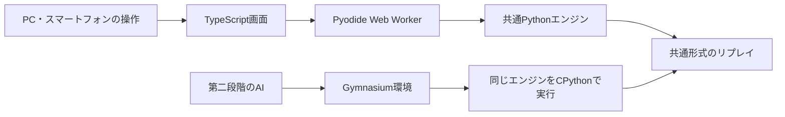

# 環境と設計

更新日: 2026-10-10。ブラウザー公開の追加要件を反映した実装方針。記載する構成・API・保存形式は未実装であり、ゲームルールの確定を意味しない。

## 構成の選択

推奨は **Python共通エンジン + Pyodide + TypeScriptのブラウザー画面**。従来案のPygame画面をブラウザー画面に変更する。

| 候補 | 利点 | コスト・課題 | 方針 |
| --- | --- | --- | --- |
| PythonエンジンをPyodideでも実行 | ブラウザーと学習で同じルール実装を使う。学習時はPythonへ直接アクセスできる | Pythonランタイムの初回読み込み、Worker連携、実行環境差の検証 | 採用する初期方針 |
| TypeScriptエンジンとPython版を別実装 | ブラウザーの起動を軽くしやすい。Pythonで通常の学習環境を使える | ルール修正を2か所へ反映し、共通データで差分検証する必要がある | 読み込み要件を満たせない場合の代替 |
| TypeScriptエンジンをNode.js経由でPythonから操作 | ルール実装は1つでブラウザーに適する | 学習時のプロセス間通信と並列環境の管理が必要。バッチ化と速度測定が必要 | 第二の代替 |

このパズルがPyodideでも十分に応答するという見込みは設計上の仮説。ルール実装を大きくする前に、起動・1手の応答・スマートフォンでの使用感を試作で確認する。

## 開発環境

| 用途 | 第一段階 | 第二段階 |
| --- | --- | --- |
| OS | Windowsで開発。PC・スマートフォンのブラウザーでプレイ | ローカル環境で開始。必要なら別の計算環境へ移行 |
| 言語 | エンジン: Python。画面: TypeScript | エンジンと学習: Python |
| 環境管理 | Python: uvと `.venv`。Web: Node.js LTSとnpm | 学習用の追加依存をPython側で管理 |
| ゲーム処理 | 標準ライブラリ中心のPythonをPyodide Worker内で実行 | 同じエンジンをCPythonで描画なしで直接実行 |
| 画面 | Vite、Canvas 2D、HTML/CSS | 同じ画面でリプレイ。リアルタイムAI観戦は別の接続方式を検討 |
| 公開 | GitHub Actionsで静的ビルドをGitHub Pagesへ配信 | 学習はローカルで実行。Pagesにはゲームと必要なリプレイを配信 |
| 検証 | pytest、Webの型・ビルド確認、ブラウザー操作確認、両ランタイムで同じ遷移データを検証 | 環境API、評価、手動プレイとの一致を追加 |
| AI | 導入しない | Gymnasium、PyTorch、Stable-Baselines3 |
| 実験記録 | ルール版、操作・生成・イベントのログ | 学習設定、seed、モデル、評価結果、TensorBoard |

現在の環境にはPython、uv、Node.jsが見つかっているが、バージョン互換性やGPU利用可否は未検証。開発用Python 3.12を候補とし、固定したPyodideが含むPythonとの共通機能を使う。互換性を確認してから開発バージョンを確定する。GPUの必要性はCPUでの処理速度を測定してから判断する。

実装開始時にPython依存を `pyproject.toml` と `uv.lock`、Web依存を `web/package.json` と `web/package-lock.json` で管理する。Pyodideの配布物も固定版にする。NumPyは学習用の観測変換で利用し、共通エンジンの必須依存にはしない。ブラウザーにはGymnasium・PyTorch・学習用パッケージを読み込まない。

参考資料:

- [uvのプロジェクト管理](https://docs.astral.sh/uv/concepts/projects/)
- [PyodideのWorker実行](https://pyodide.org/en/stable/usage/webworker.html)
- [PyodideへのPythonパッケージ読み込み](https://pyodide.org/en/stable/usage/loading-custom-python-code.html)
- [Pyodideの静的ホスティング](https://pyodide.org/en/stable/usage/downloading-and-deploying.html)
- [ViteのGitHub Pages公開](https://vite.dev/guide/static-deploy.html#github-pages)
- [Gymnasiumのカスタム環境](https://gymnasium.farama.org/main/introduction/create_custom_env/)
- [PyTorchのインストール案内](https://pytorch.org/get-started/locally/)
- [Stable-Baselines3 DQN](https://stable-baselines3.readthedocs.io/en/master/modules/dqn.html)
- [SB3 Contrib MaskablePPO](https://sb3-contrib.readthedocs.io/en/master/modules/ppo_mask.html)

## 共通エンジン



盤面遷移をTypeScriptや学習コードへ重複実装しない。エンジンはDOM、Pyodide固有API、Gymnasium、PyTorchをインポートせずに動かせる設計にする。同一コミットのエンジンをブラウザー用Pythonパッケージと学習環境へ組み込む。

ブラウザーではmodule型Workerでランタイムを一度だけ初期化し、ゲーム状態を保持する。画面は列選択などの要求を送り、状態と解決イベントを受け取る。要求IDと状態版を使い、再スタート前の古い応答を適用しない。入力を受け付ける時期や予約方式は原作の観察結果に合わせる。

落下・合体・重力・消去などの処理順は実機確認に合わせて決める。画面はエンジンが返す状態とイベントを表示し、フレームレートで論理結果が変わらないようにする。

手動プレイには自然落下のオン・オフ切替を設ける。オンでは経過時間を明示的な入力として渡し、原作の速度・開始条件・既定列は観察後に設定する。オフでは時間経過によって投入・予告・乱数を進めず、列選択で1手を開始する。配置後の重力・合体・連鎖は両方で同じ遷移として解決する。描画アニメーションと自然落下の時間進行を分ける。

自然落下の設定はリプレイと保存データへ記録する。切替は解決が終わった操作待ち状態で適用し、オンへ切り替えた際にオフ中の待機時間をまとめて進めない。原作との時間条件の比較はオンで行い、オフとAIはプロジェクト固有のターン制と表示する。

## 状態とルール設定

ゲーム状態の候補:

- 盤面、現在ブロック、予告列、得点、受理した手数、ゲーム終了状態。
- 確認された仕様に必要な過去最大値、生成候補の段階、消去段階。
- 時間進行がある場合のタイマー、落下状態、入力予約。
- 乱数生成器の状態、リプレイ用の明示的な生成列の位置。

進行履歴に依存する状態は、盤面から推測して省略しない。保存・復元・診断用の読み込みでも保持する。

ルール設定には識別子と版を付け、盤面サイズ、合体・連鎖の方式、消去条件、生成候補と重み、得点、終了条件、時間条件を定義する。確認状態は[台帳](GAME_RULES.md)のルールIDへ対応付ける。

初期の実装は読みやすさを優先する。エンジン内部ではPython整数を使い、第二段階でAIの観測へ変換する。空マスは `0` とする。盤面の座標は `[row][column]`、上から下・左から右、APIの添字は0始まりとする。

ブラウザーとの転送や共通ログでは、ブロック値・得点を10進文字列として表し、大きい整数をJavaScriptのNumberへ丸めない。行・列・時刻など安全な範囲の値は数値で扱う。手書きの観察記録は従来どおり表示値を記載し、検証用データへ変換する際に形式をそろえる。

## 第一段階の操作と診断機能

通常プレイではマウス・タッチで列を選び、キーボードでも左から1～5の列を選べるようにする方針。実機の列数が異なれば設定に合わせて変更する。画面に盤面、現在値、予告、得点、終了状態を表示する。進行状態と未確認のルールIDは診断パネルで確認できるようにする。

画面は縦長・横長、画面サイズと画素密度に対応する。描画はCanvas 2D、ボタンや操作説明はHTMLで構成する。タッチとマウスで同じ操作が二重に送られないようにする。通常画面の初期化中は進捗と再試行を表示する。

診断機能は次を用意する。

- 任意の初期盤面と必要な進行状態を読み込む。
- 生成列を指定し、乱数を使わずに同じ手順を再生する。
- 停止、1手実行、解決イベントの確認、ログ保存を行う。
- 診断パネルで使っているルール設定と未確認のルールIDを表示する。
- ブラウザーからJSON形式の設定・リプレイを読み込み、操作記録をダウンロードする。

ブラウザーのプレイデータは端末内へ保存する。学習用ファイルや動画をサーバーへアップロードする機能は初期構成に含めない。保存形式の版を持ち、古いデータを読み込めない場合は理由を表示する。

診断用に原作では作れない盤面も設定できるが、その結果を原作の挙動の証拠にはしない。通常プレイのハイスコアと診断結果は区別する。

## 記録と再現

ログに含める項目:

- ログ形式の版、エンジンの版、ルール設定の内容または識別可能なハッシュ。
- 初期状態、seed、生成されたブロック列、受理・拒否した入力。
- 必要な入力時刻・経過時間、状態の変化、得点差、解決イベント、終了理由。

seedだけでは、ルールや乱数呼び出し回数の変更後に再現できない場合がある。生成値を保存し、明示的な生成列でも再生できるようにする。

形式はJSONの設定・状態とJSON Linesのイベント記録を候補とする。大きな整数の表現は上記の転送規約とそろえる。エンジンの合体イベントなどの実際の構造は、処理順を確認してから定義する。

共通の検証用データをCPythonとブラウザーのPyodideで実行し、状態・得点・イベント・終了を比較する。まず明示的な生成列で検証し、乱数の再現性は固定ランタイム・固定生成器の条件でも別途調べる。

## 第二段階への接続

Gymnasiumの `reset(seed=...)` と `step(action)` を通して共通エンジンを操作する。AIでは自然落下を無効に固定し、1回の `step` で選択列への配置から重力・合体・連鎖・終了判定まで解決する。実時間や描画速度で状態は進まない。観測には盤面、現在・予告ブロック、ルール上必要な進行状態を含める。ブロックの指数表現はAI入力の変換として扱い、画面とログには実際の数字を残す。

原作で表示されない将来の生成列や乱数状態はAIに渡さない。追加の内部状態を渡す実験は、人間と同じ情報での実験と区別する。

合法な行動は終了条件の確認後に定義する。満杯列でも合体できる仕様なら高さだけで除外しない。ゲームオーバーになる合法手を単に除外して原作の行動を変えない。

報酬はまずゲーム得点の増分を使う候補とし、補助報酬の追加は別実験として記録する。ゲームの終了と実験上の手数・時間上限による打ち切りを区別する。

## 将来のディレクトリ構成

以下は予定であり、現在はドキュメント以外の各ディレクトリを作成していない。

```text
src/drop_the_number/
  core/          # ルール・状態・生成・遷移
  replay/        # 記録・再生
  env/           # 第二段階: Gymnasium
  agents/        # 第二段階: 比較基準・学習
web/
  src/           # TypeScript画面・Pyodide Worker連携
  public/        # 配信用の固定版ランタイム・エンジン（生成物）
  dist/          # Pagesに公開するビルド結果（Git対象外）
scripts/         # エンジン梱包、Web配布準備、動画解析補助
.github/workflows/  # 検証・静的ビルド・Pages公開
configs/         # 版付きのルール・実験設定
tests/fixtures/official/  # 実機観察由来の期待結果
docs/observations/       # 観察記録、判定、根拠
evidence/raw/            # ローカルの動画・画像（Git対象外）
evidence/derived/        # 抽出フレーム・OCR候補（Git対象外）
artifacts/               # 実行ログ・モデル（Git対象外）
```

公開の手順と確認項目は[ブラウザー公開](DEPLOYMENT.md)、動画からのルール確認は[プレイ動画の解析](VIDEO_ANALYSIS.md)を参照。
